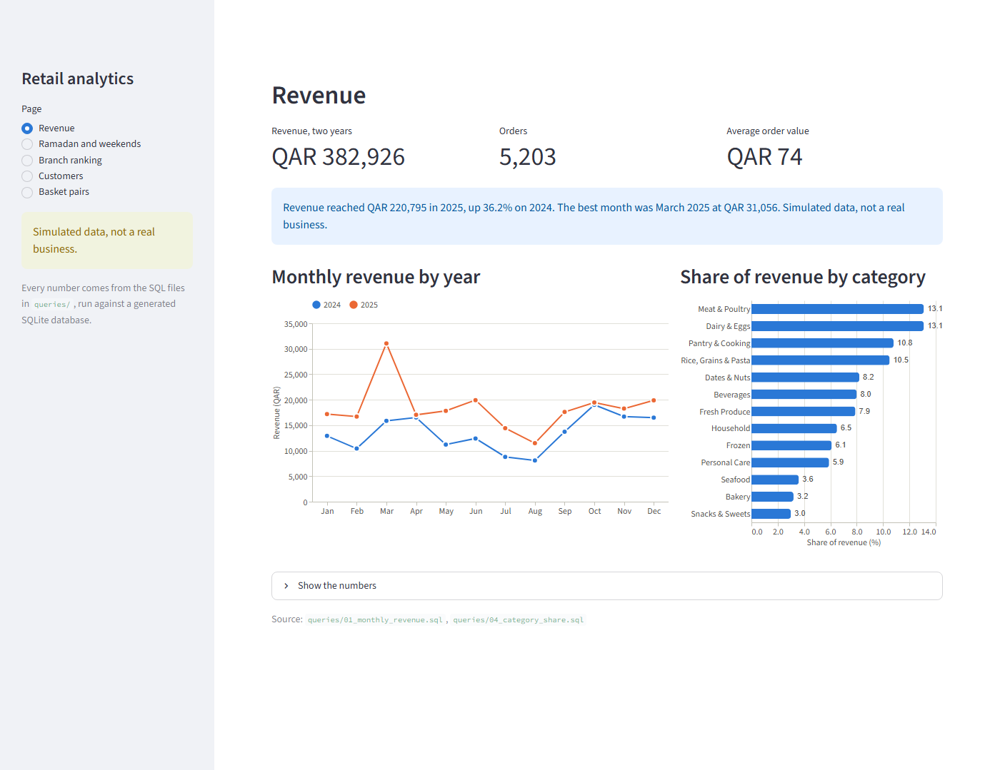
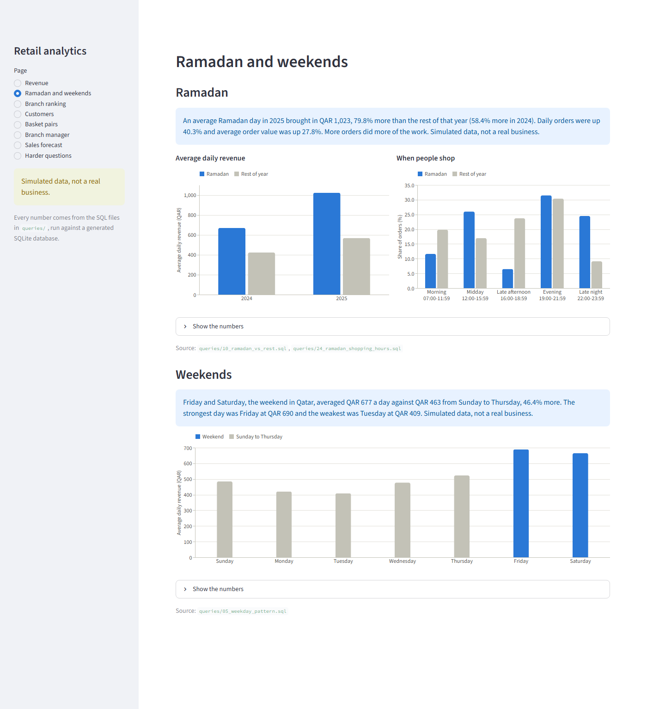
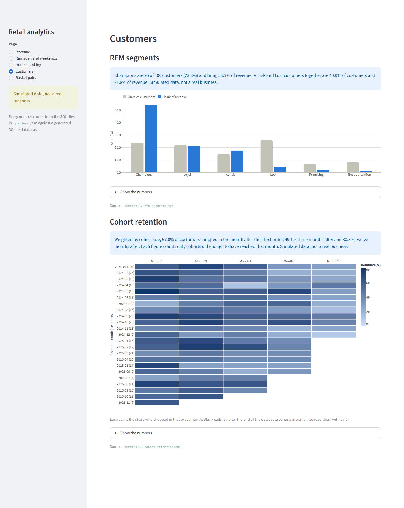
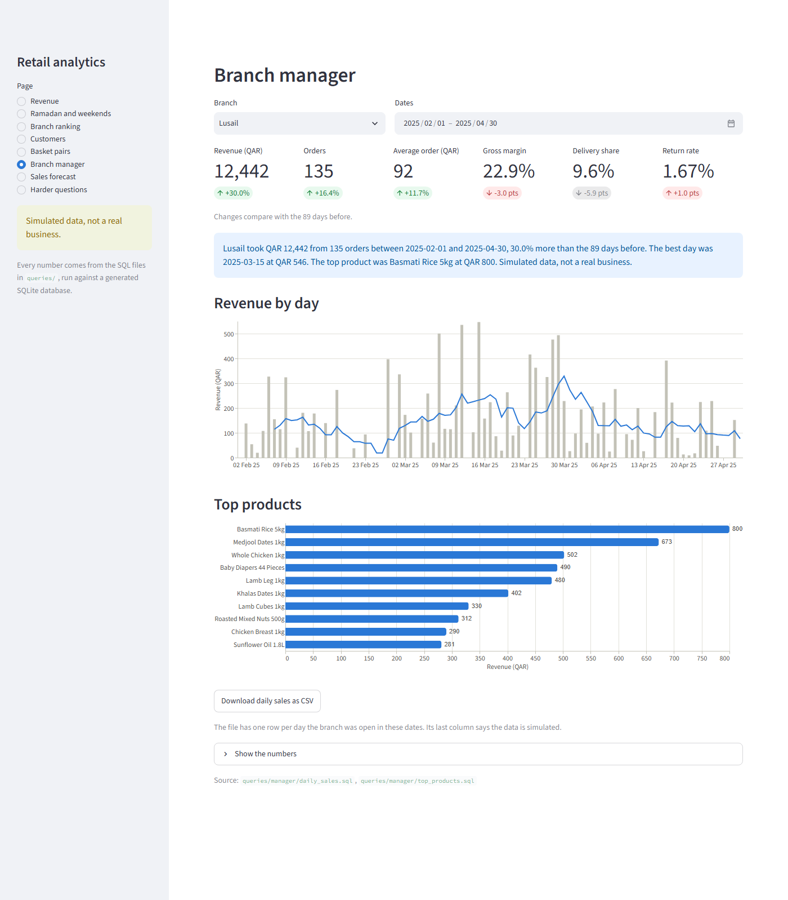
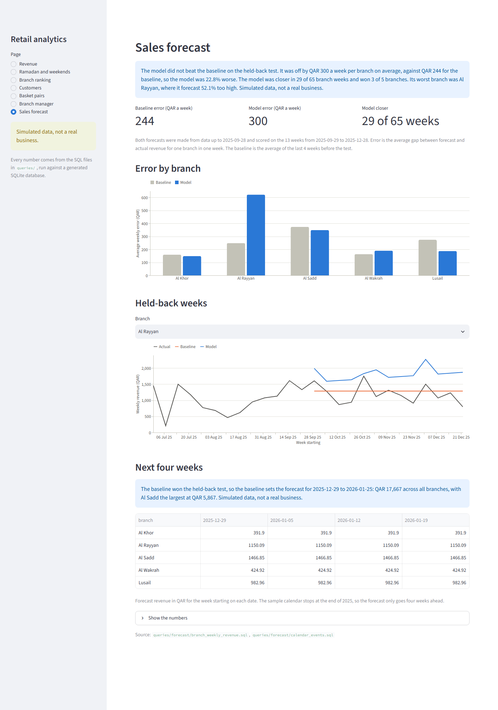

# SQL Retail Analytics

A SQL portfolio project built around a small grocery chain in Qatar. It has
a SQLite database with two years of sales across five branches (prices in
Qatari riyals, QAR) and 25 queries that answer the questions a store manager
or a commercial team would actually ask: how are sales trending, which branch
is doing best, who are the best customers, what sells together, and how much
does Ramadan change things. A Streamlit dashboard shows the main results as
charts, each with a short written finding computed from the data, and a weekly
sales forecast is tested against a simple baseline on a held-back period.

The database, the queries and `run.py` use only Python's standard library.
The dashboard and the forecast need a few packages, listed in
`requirements-dashboard.txt`.

## The data

`seed.py` builds `retail.db` from a fixed random seed, so every run gives
the same numbers. The data is made up but shaped to behave like a real chain:

| Table | Rows | What it holds |
|---|---|---|
| `branches` | 5 | Al Sadd, Al Wakrah, Al Rayyan, Al Khor and Lusail (opened September 2024) |
| `categories` | 13 | Fresh Produce, Dairy & Eggs, Dates & Nuts, Frozen and so on |
| `products` | 110 | Shelf price and supplier cost in QAR |
| `customers` | 400 | Loyalty members, their area and home branch |
| `orders` | 5,203 | Branch, time, channel (in store or delivery), payment method |
| `order_items` | 21,509 | Quantity, price and cost at the time of sale, discount, line total |
| `returns` | 299 | Returned quantity, refund and reason |
| `calendar_events` | 10 | Ramadan, Eid, summer holidays and National Day for 2024 and 2025 |

Patterns built into the data:

- The loyalty programme starts in January 2024 with a sign-up rush, then grows steadily.
- Friday and Saturday (the weekend in Qatar) are the busiest days, and the first days of the month are a bit busier after payday.
- During Ramadan people shop more often and buy more, especially dates, juices, lentils and frozen samosas. Shopping moves to the evening after iftar, and the last days before Eid spike.
- Lamb sells before Eid al-Adha. July and August are quiet because many residents travel.
- Shelf prices rise about 3% in January 2025. Six products are on a 10% promotion each week, and Ramadan staples get 15% off during Ramadan.
- Cash slowly gives way to cards and mobile wallets, and delivery grows as a share of orders.
- Some products tend to be bought together (bread and foul, spaghetti and tomato paste, Arabic coffee and cardamom).

Revenue in every query means the sum of `order_items.line_total`: after
discounts, before returns. Returns are analysed separately in Q09.

## How to run

You need Python 3 (tested on 3.12). The `sqlite3` module that ships with
Python is enough; the queries use window functions and the `WINDOW` clause,
which need SQLite 3.28 or newer.

```
python seed.py                 # builds retail.db, takes about a second
python run.py                  # runs all 25 queries and prints the results
python run.py 10 19            # runs only Q10 and Q19
python run.py --max-rows 10    # shortens long results
```

`seed.py` also takes `--db` and `--seed` if you want a different file or a
different random dataset.

To run the tests:

```
pip install -r requirements-dev.txt
python -m pytest
```

The tests build a fresh database in a temporary folder, run every query and
check that the results make sense: the expected columns come back, revenue
totals agree across queries, shares add up to 100, the running total ends at
the yearly total, the weekend is the busiest part of the week, and so on. They
also run every dashboard page through Streamlit's test runner and recompute the
written findings from the query results.

The query files are plain SQL, so you can also run them in any SQLite
client, for example `sqlite3 retail.db < queries/05_weekday_pattern.sql`.

## Dashboard

```
pip install -r requirements-dashboard.txt
streamlit run app.py
```

If `retail.db` does not exist yet, the app builds it the first time it opens.

The dashboard holds no SQL of its own. It runs the files in `queries/`, the same
files `python run.py` prints, and a test fails if SQL appears in its Python code.

| Page | What it shows | Query files |
|---|---|---|
| Revenue | Monthly revenue by year, share by category | Q01, Q04 |
| Ramadan and weekends | Ramadan against the rest of the year, shopping hours, each day of the week | Q10, Q24, Q05 |
| Branch ranking | Revenue per trading day and sales per square metre, by year | Q20, Q02 |
| Customers | RFM segments and monthly cohort retention | Q17, Q18 |
| Basket pairs | Pairs bought together, ranked by lift | Q19 |
| Branch manager | One branch and date range: sales, change on the period before, top products, CSV | `queries/manager/` |
| Sales forecast | The forecast test, error by branch, and the next four weeks | `queries/forecast/` |

Each section has a finding such as "Friday and Saturday, the weekend in Qatar,
averaged QAR 677 a day against QAR 463 from Sunday to Thursday". The sentences
are built from the query results, so they change if the data changes. The data
is generated, so every finding ends by saying it is simulated data, not a real
business, and the sidebar says the same on every page. Every chart has a table
of its numbers below it.







### Branch manager view

Pick a branch and a date range to see that branch's revenue, orders, average
order, gross margin, delivery share and return rate, each compared with the same
number of days before. The daily sales for those dates download as a CSV, and
the last column of the file says the data is simulated.

Filters need parameters, so this page runs the files in `queries/manager/`. They
are ordinary .sql files that take `:branch_id`, `:start_date` and `:end_date`.
Three rules keep the numbers fair:

- A day with no orders counts as zero, but days before a branch opened do not count at all.
- If the period before is cut short by the opening date or the start of the data, no change is shown. Comparing with half a period would give a large growth figure that means nothing.
- A link can open the page on a branch and dates, for example `?view=manager&branch=Lusail&start=2025-02-01&end=2025-04-30`.



### How the screenshots were taken

The screenshots are real captures of the running app, taken with headless Edge
by `python tools/take_screenshots.py`. The script stops without saving if a page
shows an error or has no simulated-data notice. The other pages are in
`docs/screenshots/`.

## Sales forecast

**The model did not beat the baseline.** On the 13 weeks held back, it was off
by QAR 300 a week per branch on average, against QAR 244 for the baseline, which
makes it 22.8% worse. This describes simulated data, not a real business.

```
python forecast.py
```

| Branch | Average weekly revenue (QAR) | Baseline error (QAR) | Model error (QAR) | Closer |
|---|---:|---:|---:|---|
| Al Khor | 397 | 160 | 149 | Model |
| Al Rayyan | 1,194 | 249 | 622 | Baseline |
| Al Sadd | 1,387 | 374 | 349 | Model |
| Al Wakrah | 484 | 164 | 191 | Baseline |
| Lusail | 883 | 274 | 188 | Model |

How the test works:

- The target is revenue per branch per full Monday to Sunday week. Days are too noisy, because a branch takes one to three orders on a day it trades, and some days none. Part-weeks at the end of the data and at Lusail's opening are left out.
- The last 13 full weeks, 2025-09-29 to 2025-12-28, are held back. Both methods see only the weeks before that and forecast the whole period in one go.
- The baseline is the average of the last 4 weeks before the test, held flat. Same week last year is not used, because Ramadan moves and Lusail has no full year before the test.
- The model is a straight-line fit on log revenue for each branch, with a trend and the share of each week in Ramadan, Eid, the summer holidays and the days after payday. All of those are known in advance.
- The winner is whichever has the lower average error across all branch weeks. A test checks that changing the held-back revenue does not change either forecast.

Why it lost: the model's advantage is knowing the calendar, and this test period
has almost no events in it. What remains is its trend, which carried Al Rayyan's
fast growth forward and over-forecast that branch by 52.1%. The model was closer
at three of the five branches, but its Al Rayyan miss outweighed them.

This was not bad luck on one dataset. The same design, unchanged, lost on 9 of
10 other seeds, with a median error about 10% above the baseline. To repeat
that, run
`python seed.py --db other.db --seed 1`, then `python forecast.py --db other.db`.

Because the baseline won, the baseline sets the next four weeks shown on the
dashboard. The model was left as it was once the test had been run: changing it
now and scoring it on the same weeks would no longer be a fair test. The design
was chosen on a validation window inside the training data, where the model did
win, but that window was the summer, when knowing the calendar helps most.



## Project layout

```
schema.sql                  tables, keys, checks and indexes
seed.py                     builds retail.db
run.py                      runs the queries and prints tables
queries/                    one .sql file per business question
queries/manager/            parameterised .sql files for the branch manager page
queries/forecast/           .sql files that feed the forecast
forecast.py                 the weekly forecast, its baseline and the held-back test
app.py                      Streamlit entry point
dashboard/                  data loading, written findings, charts and pages
tools/take_screenshots.py   captures the README screenshots with headless Edge
docs/screenshots/           those screenshots
tests/                      pytest tests for the data, the queries, run.py and the dashboard
```

## The 25 questions

| # | Question | SQL used |
|---|---|---|
| 01 | Monthly revenue, order count and average order value | GROUP BY, date functions |
| 02 | Branch comparison on orders, customers, revenue and margin | CTE, share of total with a window |
| 03 | Top 10 products by revenue and their margin | Joins, ORDER BY with LIMIT |
| 04 | Share of revenue and gross profit by category | CTE, window totals |
| 05 | Average daily revenue by day of the week | Recursive calendar CTE, LEFT JOIN |
| 06 | Payment method mix by year | Window share partitioned by year |
| 07 | In-store vs delivery basket size and value | Per-order CTE |
| 08 | Active, new and returning customers each month | CTE, running count |
| 09 | Return rate and top return reason by category | Several CTEs, ROW_NUMBER |
| 10 | Ramadan vs the rest of the year | Recursive calendar, EXISTS, window |
| 11 | Month-over-month revenue change | LAG with a named window |
| 12 | Year-over-year growth by category | Conditional aggregation |
| 13 | Year-to-date running total | SUM over a window frame |
| 14 | Branch that led each month and its lead over the runner-up | ROW_NUMBER, pivot with CASE |
| 15 | Top 3 products in each category | ROW_NUMBER per partition |
| 16 | Top 10 customers by lifetime spend | CTE, date arithmetic |
| 17 | RFM segmentation | NTILE scoring, CASE segments |
| 18 | Monthly cohort retention | Month index, conditional COUNT DISTINCT |
| 19 | Products bought together (support, confidence, lift) | Self join |
| 20 | Branch ranking by daily revenue and sales per square metre | CROSS JOIN, RANK |
| 21 | Peak 7-day rolling revenue in each month | Window frame, correlated subquery |
| 22 | Regular customers who are overdue for a visit | LAG, HAVING |
| 23 | Discounted vs full-price lines | CASE grouping, window share |
| 24 | Ramadan shopping hours vs normal hours | EXISTS, banding, window share |
| 25 | Delivery share by quarter | Quarter buckets, LAG |

## Example output

These are pasted from `python run.py` on the default seed.

**Q10: Ramadan days bring in far more revenue than ordinary days**

```
Q10. How much busier is an average day in Ramadan than the rest of the year?
[10_ramadan_vs_rest.sql, 4 rows]

year  period        days  avg_daily_orders  avg_daily_revenue_qar  avg_order_value_qar  revenue_uplift_pct
----  ------------  ----  ----------------  ---------------------  -------------------  ------------------
2024  Ramadan         30               7.1                 669.56                93.86                58.4
2024  Rest of year   336               6.2                 422.75                67.67                 0.0
2025  Ramadan         29              10.8               1,022.82                94.77                79.8
2025  Rest of year   336               7.7                 568.85                74.17                 0.0
```

**Q19: Basket pairs, sorted by lift** (`python run.py 19 --max-rows 8`)

```
Q19. Which pairs of products are bought together far more often than chance would suggest?
[19_basket_pairs.sql, 15 rows]

product_a                 product_b                      orders_together  support_pct  confidence_a_to_b   lift
------------------------  -----------------------------  ---------------  -----------  -----------------  -----
Frozen Samosas 24 Pieces  Frozen Spring Rolls 20 Pieces               30         0.58              0.423  24.98
Cream Cheese Spread 500g  Kunafa Dough 500g                           36         0.69              0.194  17.98
Arabic Coffee 250g        Cardamom 100g                               53         1.02              0.276  12.38
Arabic Coffee 250g        Khalas Dates 1kg                            76         1.46              0.396  10.45
Cheddar Slices 200g       Beef Burger Patties 8 Pieces                55         1.06              0.224   9.38
Shampoo 400ml             Shower Gel 500ml                            25         0.48              0.191   8.27
Tomato Ketchup 500g       Frozen French Fries 2.5kg                   84         1.61              0.339   7.83
Minced Beef 500g          Spaghetti 500g                              82         1.58              0.373   6.12
... 7 more rows
```

**Q24: Shopping moves to the evening during Ramadan**

```
Q24. At what time of day do people shop during Ramadan compared with the rest of the year?
[24_ramadan_shopping_hours.sql, 5 rows]

time_band                     ramadan_orders  ramadan_share_pct  other_orders  other_share_pct
----------------------------  --------------  -----------------  ------------  ---------------
Morning (07:00-11:59)                     61               11.6           925             19.8
Midday (12:00-15:59)                     137               26.0           797             17.0
Late afternoon (16:00-18:59)              34                6.5         1,106             23.7
Evening (19:00-21:59)                    166               31.5         1,423             30.4
Late night (22:00-23:59)                 129               24.5           425              9.1
```

## A few things the queries show

Because the data is made up, these are patterns `seed.py` was written to
produce. The point is that the SQL finds them and puts numbers on them.

- Friday and Saturday average about QAR 690 and QAR 665 a day, against about QAR 410 to 420 on Monday and Tuesday (Q05).
- Lusail only opened in September 2024 but was already third of five branches on daily revenue in 2025 (Q20).
- Cash fell from 31.3% of orders in 2024 to 24.6% in 2025, while wallet payments went from 10.1% to 17.2% (Q06).
- Delivery grew from 7.5% of orders in the first quarter of 2024 to 18.5% in the last quarter of 2025 (Q25).
- Discounted lines carry a gross margin of about 15 to 16%, against about 26% at full price (Q23).

## Notes

- Customer names are random combinations of common first and family names. They are not real people.
- Ramadan and Eid dates follow the dates observed in Qatar in 2024 and 2025.
- `retail.db` is not committed. Run `python seed.py` to build it, or open the dashboard, which builds it if it is missing.

## License

MIT. See [LICENSE](LICENSE).
